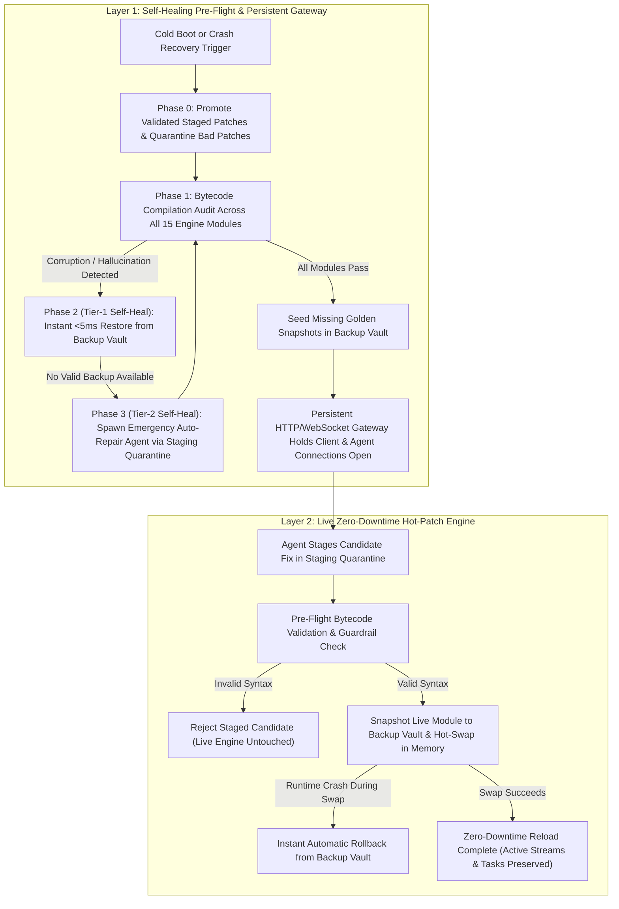

[//]: # (DOC_ID: SIRA-DEV-BOOTSTRAP_PREFLIGH | VERSION: v1.0 | SCOPE: DEV)

# Bootstrap Pre-Flight Self-Healing & Dual-Layer Uptime Architecture

[//]: # (SECTION_ID: SIRA-DEV-BOOTSTRAP_PREFLIGH-SEC-1)
## Executive Summary
[//]: # (SECTION_ID: SIRA-DOC-PREFLIGHT-SEC-1)

When an autonomous AI agent is given administrative power to write code, refactor backend modules, and debug live infrastructure, the greatest threat to system availability is **Agentic Hallucination & Rogue Mutation**. An agent may hallucinate non-existent libraries, emit truncated code blocks, introduce fatal indentation errors, or attempt destructive "edit-and-restart" loops that sever its own communication channel.

If an agent breaks the server hosting its own orchestration loop, the system enters a **"Brain-Dead Lockout"**: the server cannot boot because the code is broken, and the agent cannot fix the code because the server that runs the agent is offline.

To mathematically eliminate this failure mode, the platform implements a **Dual-Layer Uptime & Self-Healing Architecture**:
1. **Layer 1 — The Self-Healing Pre-Flight Supervisor & Persistent Connection Gateway**: Protects the system at cold boot, across process restarts, and during catastrophic crashes while holding client and agent WebSocket connections permanently open.
2. **Layer 2 — The Zero-Downtime In-Memory Hot-Patch Engine**: Protects the system during live runtime evolution by staging, compiling, snapshotting, and hot-swapping modules in memory without ever dropping the active process.

---

[//]: # (SECTION_ID: SIRA-DEV-BOOTSTRAP_PREFLIGH-SEC-1)
## 1. Why Rogue or Hallucinating Agents Threaten System Uptime
[//]: # (SECTION_ID: SIRA-DOC-PREFLIGHT-SEC-1)

Even highly capable frontier models exhibit failure modes under complex multi-file engineering tasks:
- **Syntax & Indentation Hallucinations**: Generating unclosed parentheses, mismatched string literals, or mixed indentation levels that immediately trigger fatal compilation errors (`SyntaxError` / `IndentationError`) upon module import.
- **Phantom APIs & Broken Imports**: Hallucinating methods or library imports learned from outdated public repositories that fail at startup or crash during request handling.
- **Truncated File Overwrites**: Emitting partial file replacements or markdown code fences (` ```python `) directly into source files, corrupting the module on disk.
- **Self-Severed Communication Channels**: If an agent crashes the backend process during a repair attempt, standard WebSocket connections drop immediately—cutting off the user's screen-reader stream, losing unacknowledged messages, and killing the agent subprocess before it can restore the system.

---

[//]: # (SECTION_ID: SIRA-DEV-BOOTSTRAP_PREFLIGH-SEC-2)
## 2. The Two Layers of Uptime Protection
[//]: # (SECTION_ID: SIRA-DOC-PREFLIGHT-SEC-2)

Together, the **Self-Healing Pre-Flight Check** and the **Zero-Downtime Hot-Patch Sequence** form a closed-loop survival system where neither a syntax hallucination nor a runtime exception can permanently down the platform or sever the persistent connection to the user and agent.



[//]: # (SECTION_ID: SIRA-DEV-BOOTSTRAP_PREFLIGH-SEC-2)
### Layer 1: The Self-Healing Pre-Flight Supervisor & Persistent Gateway
[//]: # (SECTION_ID: SIRA-DOC-PREFLIGHT-SEC-2)
Layer 1 executes automatically before the backend engine binds its listener port, during manual pre-flight audits, and immediately following any unexpected runtime crash:

1. **Phase 0 — Staged Hot-Patch Promotion & Bad-Patch Quarantine**:
   - Inspects the **Staging Quarantine Directory** for any pending candidate modules left by an agent.
   - Rejects and purges any candidate targeting locked **Security Firewall Guardrails**.
   - Bytecode-compiles each candidate: valid patches are promoted into the engine and backed up; syntax-corrupted patches are automatically quarantined and removed before they can touch the runtime.
2. **Phase 1 — Comprehensive 15-Module Bytecode Audit**:
   - Performs deterministic bytecode compilation across every core router, session manager, workspace controller, agent execution mixin, and security resolver module.
   - Whenever a healthy module passes verification and lacks a backup, the supervisor automatically seeds a golden snapshot into the **Backup Vault**.
3. **Phase 2 — Tier-1 Instant Self-Healing (`< 5ms` Backup Vault Restore)**:
   - If a rogue agent or disk fault corrupts an engine module, the Pre-Flight Supervisor does not immediately wait on an external AI call.
   - Instead, it checks the **Backup Vault** for the last verified golden snapshot of that module, verifies the backup's bytecode integrity, and restores it atomically in under 5 milliseconds.
4. **Phase 3 — Tier-2 AI Emergency Auto-Repair Agent (Firewall-Compliant)**:
   - In the rare event that a corrupted file has no valid backup in the Backup Vault, the supervisor spawns a headless **Emergency Auto-Repair Agent** with the exact compilation traceback.
   - To comply with the **Pre-Execution Memory Interceptor**, the repair agent is instructed to write the corrected module strictly into the **Staging Quarantine Directory**.
   - Once the agent exits, the Pre-Flight Supervisor compiles the staged repair, promotes it into the live engine, and seeds a fresh golden backup.
5. **Persistent HTTP & WebSocket Connection Gateway**:
   - Sits in front of the backend engine and maintains a permanent WebSocket bridge and 4-second keep-alive heartbeat with the browser client.
   - When the backend reloads or recovers from a crash, the gateway **never cancels the client listener task**. Instead, it emits a status notification (*"Engine reloading or running tasks. Connection preserved by Bootstrap Gateway..."*), buffers any prompts sent by the user while the backend is offline, and automatically replays those queued messages the instant the backend reconnects.

[//]: # (SECTION_ID: SIRA-DEV-BOOTSTRAP_PREFLIGH-SEC-3)
### Layer 2: The Zero-Downtime In-Memory Hot-Patch Engine
[//]: # (SECTION_ID: SIRA-DOC-PREFLIGHT-SEC-3)
While Layer 1 guards startup, crash recovery, and socket persistence, Layer 2 governs live code mutations while the server is actively handling traffic:

1. **Pre-Execution Interception of Direct Edits**:
   - The **Pre-Execution Memory Interceptor** blocks any agent tool call that attempts to overwrite a live engine module in place, forcing all modifications into the **Staging Quarantine Directory**.
2. **Live Bytecode Gate & Snapshot Creation**:
   - When the hot-patch endpoint is triggered, candidate files are compiled inside quarantine. If compilation passes, the currently running live module is copied into the **Backup Vault** (feeding Layer 1's recovery store).
3. **In-Memory Class Reload & Dynamic Route Rebinding**:
   - Active WebSocket client queues, running agent subprocess handles, and workspace states are captured in memory, modules are reloaded in-process, updated HTTP/WebSocket handlers are rebound onto the live router, and client queues are re-attached with **zero dropped frames**.
4. **Automated Runtime Rollback**:
   - If a module compiles cleanly but raises an exception during in-memory initialization, the engine immediately restores the snapshot from the **Backup Vault** and reloads the previous working state without dropping the process.

---

[//]: # (SECTION_ID: SIRA-DEV-BOOTSTRAP_PREFLIGH-SEC-3)
## 3. Defense Matrix: How the Two Layers Defeat Rogue Agent Failures
[//]: # (SECTION_ID: SIRA-DOC-PREFLIGHT-SEC-3)

| Rogue Agent / Hallucination Scenario | Layer 1: Pre-Flight & Persistent Gateway | Layer 2: Live Hot-Patch Engine | Net Uptime Impact |
| :--- | :--- | :--- | :--- |
| **Agent attempts to edit a live server file directly** | N/A (Intercepted pre-write) | Blocked by Pre-Execution Interceptor; forced into Staging Quarantine | **100% Uptime** (Live file untouched) |
| **Agent stages a file with hallucinated syntax errors** | Phase 0 quarantines & purges the broken staged file | Stage 3 aborts hot-patch before copying to live engine | **100% Uptime** (Zero impact) |
| **Agent stages code that compiles but crashes on reload** | Golden backup remains intact in Backup Vault | Stage 7 catches exception and auto-rolls back from Backup Vault | **100% Uptime** (Self-healed in memory) |
| **Live engine file corrupted on disk while offline** | Phase 2 detects syntax error & restores from Backup Vault in `<5ms` | N/A (Healed prior to server bind) | **Instant Recovery** |
| **File corrupted with no existing backup** | Phase 3 spawns Auto-Repair Agent to stage & validate fix in Quarantine | Staged fix promoted and backed up | **Autonomous Recovery** |
| **Backend engine restarts during active user session** | Persistent Gateway holds WebSocket open, queues client messages & replays on reconnect | Preserves in-memory ACK queues during live reloads | **Zero Dropped Sessions** |

---

[//]: # (SECTION_ID: SIRA-DEV-BOOTSTRAP_PREFLIGH-SEC-4)
## 4. Non-Destructive 4-Stage Verification Harness
[//]: # (SECTION_ID: SIRA-DOC-PREFLIGHT-SEC-4)

Because testing crash recovery and gateway failover against a live production port would disrupt active users, the Bootstrap Supervisor includes a built-in, isolated **4-Stage Self-Test Suite**:

1. **Test 1 — Live Engine Pre-Flight Audit**: Verifies that all 15 engine modules pass bytecode compilation and have up-to-date golden snapshots in the Backup Vault.
2. **Test 2 — Sandbox Corruption & Tier-1 Instant Backup Self-Heal**: Creates an isolated temporary sandbox, injects a fatal syntax error into a simulated server module, and verifies that the Pre-Flight Supervisor detects the fault and restores the valid module from the Backup Vault automatically.
3. **Test 3 — Staged Hot-Patch Promotion & Guardrail Quarantine**: Verifies in an isolated sandbox that valid staged patches are promoted and backed up, while syntax-corrupted patches and protected security guardrail filenames are rejected and purged.
4. **Test 4 — Ephemeral Loopback Gateway Failover Simulation**: Spins up the Persistent Gateway and a mock backend on ephemeral loopback ports, connects a real WebSocket client, terminates the mock backend mid-session, queues a client message while the backend is offline, verifies the client connection remains open with a preservation notice, restarts the mock backend, and verifies automatic reconnection and queued message replay.
