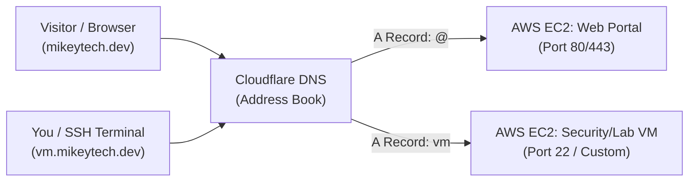

# Beginner's Guide: Domain Registration, DNS, and AWS VM Hosting

A step-by-step, plain-English handbook for registering your domain, setting up an AWS cloud Virtual Machine (VM), configuring DNS records, and linking web applications and remote servers.

---

## 1. Domain Availability Live Results

We ran live RDAP registry lookups on the target candidate names. Here are the verified availability results:

| Candidate Domain | Status | Best Suited For |
| :--- | :--- | :--- |
| **`mikeytech.dev`** | **OWNED & ACTIVE** | **Your Main Domain**: Registered via Cloudflare, managed with Cloudflare DNS. |
| **`devcorelabs.dev`** | **AVAILABLE** | Alternative: Covers software development and VM lab infrastructure. |
| **`devcore-ops.com`** | **AVAILABLE** | Systems administration, cloud operations, and infrastructure. |
| **`devcorecloud.dev`** | **AVAILABLE** | Direct focus on cloud hosting, remote servers, and APIs. |
| **`devcorehub.dev`** | **AVAILABLE** | Central management hub for projects, agents, and apps. |
| **`siraugga.dev`** | **AVAILABLE** | Framework and AI agent brand anchor. |
| **`mikeyrobberts.dev`**| **AVAILABLE** | Personal developer portfolio brand (`e_profile`). |
| `devcore.dev` | Taken | Registered and parked. |
| `devcorelabs.com` | Taken | Registered and parked. |
| `devcore.cloud` | Taken | Registered. |

> [!TIP]
> If you want a single unified domain for DevCore, your website, and your remote VMs, **`devcorelabs.dev`** provides the cleanest naming convention and professional tech identity.

---

## 2. Architecture Overview: How It All Fits Together

Here is the flow of how a user or screen reader visits your website or connects to your VM:



---

## 3. Step-by-Step Execution Checklist

### Phase 1: Purchase the Domain (COMPLETED)
1. **Registered Domain**: **`mikeytech.dev`** registered via **Cloudflare Registrar**.
2. **WHOIS Privacy / Data Redaction**: Enabled automatically and free forever. Masks your real name, phone number, home address, and personal email from public database lookups.
3. **Nameservers**: Managed by Cloudflare (`gannon.ns.cloudflare.com`, `sara.ns.cloudflare.com`).

---

### Phase 1.5: Understanding the Cloudflare Post-Registration Options

When your domain registration completes, Cloudflare presents four main options under "Next steps":

#### 1. Manage domain ("Configure DNS, WHOIS privacy and auto-renewal")
* **What it does**: This is your master settings dashboard for `mikeytech.dev`.
* **Key areas inside**:
  * **DNS (Domain Name System)**: The address book where you create `A` and `CNAME` records to point your domain to your AWS server's IP address. **This is the only setting required for your website and VMs.**
  * **WHOIS Privacy**: Keeps your personal address, phone number, and identity hidden from public directories (Cloudflare keeps this on by default).
  * **Auto-renewal**: Controls whether Cloudflare automatically renews your domain each year at cost (~$10.18/yr) so your website never unexpectedly goes offline.

#### 2. Deploy a site ("Launch a website or app in seconds using Workers")
* **What it does**: Cloudflare's serverless hosting platform (Workers & Pages).
* **How it works**: Instead of running a virtual computer (like Ubuntu on AWS), you upload single web pages or lightweight scripts directly to Cloudflare's global edge network.
* **When to use it**: Great for instant static portfolios, redirect links, or "Coming Soon" pages with zero server maintenance.
* **Limitation**: Cannot run a full Linux VM, terminal tools, or heavy background processes like DevCore.

#### 3. Set up custom email ("Create custom addresses and forward messages to any inbox")
* **What it does**: Free email forwarding (Cloudflare Email Routing).
* **How it works**: Allows you to create professional email addresses (e.g., `michael@mikeytech.dev` or `admin@mikeytech.dev`) that automatically forward incoming mail directly into your personal email (such as `@gmail.com` or `@outlook.com`).
* **Why it matters**: Gives you a professional branded email address for resumes, clients, or portfolios completely free, without paying $6–$12/month for Google Workspace or Microsoft 365.

#### 4. Register a new domain ("Buy a new domain at cost, with no markup fees")
* **What it does**: The search and purchase tool for registering additional domains.
* **When to use it**: Only needed if you decide to buy additional domain names in the future (e.g., `devcorelabs.dev`). You can safely skip this right now.

---

### Phase 2: Launch Your Virtual Machine on AWS
1. **Log in to the AWS Console**:
   - Navigate to the **EC2 Dashboard** (Elastic Compute Cloud).
2. **Launch an Instance**:
   - Click **Launch Instance**.
   - **Name**: e.g., `devcore-primary-server`.
   - **OS Image**: Select **Ubuntu Server 24.04 LTS** (stable, beginner-friendly, and broad community support).
   - **Instance Type**: 
     - For learning/testing: `t4g.small` or `t3.micro` (eligible for AWS Free Tier).
     - For active labs/Docker: `t3.medium` or `t3.large`.
   - **Key Pair**: Create a new `.pem` key pair (e.g., `devcore-key.pem`) and download it to your local machine. You will need this key to log in.
3. **Configure the Security Group (Firewall)**:
   - Allow **SSH (Port 22)**: Set source to "My IP" for maximum security.
   - Allow **HTTP (Port 80)**: Source set to Anywhere (`0.0.0.0/0`).
   - Allow **HTTPS (Port 443)**: Source set to Anywhere (`0.0.0.0/0`).
4. **Allocate an Elastic IP (Crucial Step)**:
   - AWS instances normally change their public IP address every time they are stopped and started.
   - In the EC2 left sidebar, click **Elastic IPs** &rarr; **Allocate Elastic IP address**.
   - Select the newly created IP &rarr; **Actions** &rarr; **Associate Elastic IP address**.
   - Select your running instance. Now your server has a permanent static IP address that will never change.

---

### Phase 3: Link Your Domain to Your Server (DNS Setup)
In your domain registrar dashboard (e.g., Cloudflare or Namecheap), open the **DNS Management** tab:

1. **Root Domain (Website)**:
   - **Type**: `A`
   - **Name**: `@` (or leave blank; this stands for the root domain `mikeytech.dev`)
   - **Value / Target**: `YOUR_AWS_ELASTIC_IP` (e.g., `54.210.15.42`)
   - **TTL**: `Auto` (or `300` seconds)
2. **Subdomain for VM Access**:
   - **Type**: `A`
   - **Name**: `vm` (creates `vm.mikeytech.dev`)
   - **Value / Target**: `YOUR_AWS_ELASTIC_IP` (or a second VM's Elastic IP)
   - **TTL**: `Auto`
3. **Subdomain for AI / Agent Portal**:
   - **Type**: `A`
   - **Name**: `agent` (creates `agent.mikeytech.dev`)
   - **Value / Target**: `YOUR_AWS_ELASTIC_IP`

---

### Phase 3.5: Subdomain Architecture & Security Hardening (DNSSEC)

#### 1. Subdomain Capacity & Wildcards
* **Cost**: **$0 (100% Free)**. Subdomains never cost extra money.
* **Direct Records (Up to 1,000)**: Cloudflare's free tier permits up to 1,000 individual DNS records per domain. You can create distinct subdomains pointing to different AWS instances, ports, or web apps:
  * `devcore.mikeytech.dev` &rarr; DevCore Web Portal
  * `lab.mikeytech.dev` &rarr; Security Lab / Remote Linux Desktop
  * `api.mikeytech.dev` &rarr; Backend APIs and webhooks
* **Wildcard Record (`*.mikeytech.dev`)**: Adding an `A` record with name `*` creates an infinite catch-all. Any prefix typed before your domain automatically routes to your server without needing individual DNS entries.
* **SSL / HTTPS Coverage**: Cloudflare's free Universal SSL automatically generates certificates covering both the apex domain (`mikeytech.dev`) and one level of wildcard subdomains (`*.mikeytech.dev`).

#### 2. DNSSEC (Domain Name System Security Extensions)
* **What it does**: Attaches a tamper-evident cryptographic digital signature to all published DNS records.
* **The Threat It Prevents**:
  * **DNS Spoofing & Cache Poisoning**: In traditional unauthenticated DNS, an attacker intercepting network traffic (e.g., on public Wi-Fi or compromised router/ISP nodes) can send a forged IP answer to redirect your visitors to a malicious clone server.
* **How It Protects You**:
  * Cloudflare signs your DNS records with a private cryptographic key.
  * When a visitor's resolver looks up `mikeytech.dev`, it validates the signature against the public key anchored in Google's `.dev` top-level registry.
  * Any forged or modified DNS reply fails mathematical verification and is immediately rejected by the client browser.
* **How to Enable in Cloudflare**:
  * In the Cloudflare dashboard, navigate to **DNS** &rarr; **Settings**.
  * Under **DNSSEC**, click **Enable DNSSEC**. Cloudflare handles key generation, zone signing, and automated key rotation with zero maintenance.

---

### Phase 4: Verification from the Command Line
Once DNS records are saved, verify them from your WSL or Linux terminal without opening a browser:

```bash
# 1. Check if the domain points to your Elastic IP
dig mikeytech.dev +short

# 2. Check the subdomain
dig vm.mikeytech.dev +short

# 3. Test SSH connection using your domain name
ssh -i /path/to/devcore-key.pem ubuntu@vm.mikeytech.dev
```

---

## 4. Understanding Key Concepts & Glossary

* **A Record (Address Record)**:
  - Links a domain name directly to an IPv4 address (e.g., `mikeytech.dev` &rarr; `54.210.15.42`).
* **CNAME Record (Canonical Name)**:
  - An alias that points one name to another name instead of an IP (e.g., `www.mikeytech.dev` &rarr; `mikeytech.dev`).
* **DNS Propagation**:
  - The short delay (usually 2 to 15 minutes) while internet service providers around the world update their address books to recognize your new settings.
* **DNSSEC (Domain Name System Security Extensions)**:
  - Cryptographically signs DNS records to guarantee authenticity, preventing attackers from injecting forged DNS answers or spoofing your server's IP address.
* **Elastic IP (Static IP)**:
  - An IP address provided by AWS that remains fixed to your server, ensuring your domain records never break when restarting the virtual machine.
* **HSTS Preloading (`.dev`)**:
  - The security standard enforced by Google on all `.dev` domains. Web browsers automatically mandate encrypted HTTPS connections and refuse unencrypted HTTP.
* **Wildcard Subdomain (`*`)**:
  - A catch-all DNS record (e.g., `*.mikeytech.dev`) that routes all undefined subdomain requests to a designated target without requiring separate individual entries.

---

## 5. Quick Recovery & Troubleshooting Reference

| Symptom | Probable Cause | Action to Take |
| :--- | :--- | :--- |
| Browser says "Site cannot be reached" right after setup. | DNS propagation is still in progress. | Wait 5–10 minutes. Run `dig yourdomain.dev +short` in your terminal to see if the IP responds. |
| SSH connection times out when typing `ssh ubuntu@vm.yourdomain.dev`. | AWS Security Group is blocking Port 22. | In AWS EC2, edit the Security Group Inbound Rules to ensure Port 22 is open for your current IP. |
| Browser shows an SSL/HTTPS warning on `.dev`. | Web server does not have an SSL certificate installed yet. | Run `sudo certbot --nginx` or `certbot --apache` on your VM to issue a free Let's Encrypt certificate. |
